<p align="center">
  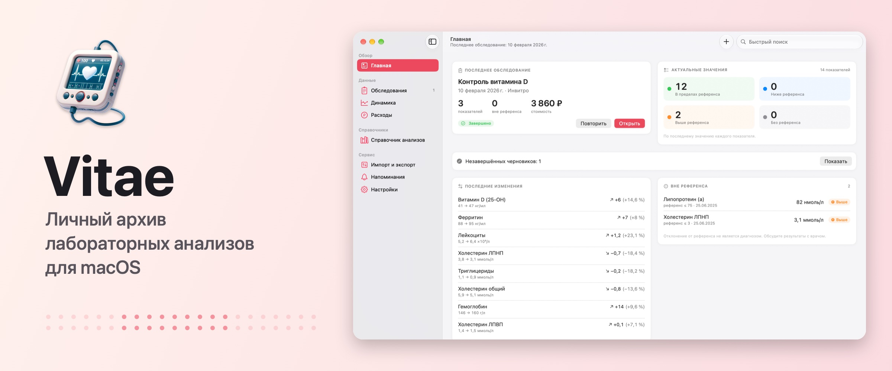
</p>

<h1 align="center">Vitae: личный архив анализов для macOS</h1>

<p align="center">
  Нативное приложение для Mac на SwiftUI и SwiftData.<br>
  Обследования, результаты с референсами вашей лаборатории, динамика показателей и расходы на анализы за многие годы.
</p>

<p align="center">
  
  
  
  
  
</p>

<p align="center">
  📬 <a href="mailto:mrgsdev@gmail.com">mrgsdev@gmail.com</a>
</p>

---

## Коротко

**Всё про ваши анализы в одном месте:** обследования за годы, результаты с референсами конкретной лаборатории,
статусы «в пределах», «ниже» и «выше», графики динамики, сравнение двух обследований, расходы и история цен,
документы с бланками, напоминания о повторной сдаче.

**Чего нет в личном кабинете лаборатории:** анализы из разных лабораторий в одной истории, пересчёт единиц
(ммоль/л ↔ мг/дл, г/л ↔ г/дл), табличный ввод в стиле Numbers со вставкой столбца из Excel, распознавание
бланков PDF и фото, резервные копии, PDF-отчёты и полная работа без интернета: данные не покидают ваш Mac.

## Почему Vitae

**Vitae** (читается «ви́тэ») — латинское слово, форма *vita*, «жизнь»: *vitae* значит «жизни».
Оно знакомо по выражению *curriculum vitae* — «ход жизни»: так называют резюме, краткую историю пути человека.

Vitae — это curriculum vitae вашего здоровья. Приложение хранит многолетнюю историю анализов, где каждый
показатель виден не как случайная цифра на бланке, а как линия во времени. Короткое слово с понятным смыслом,
без медицинского пафоса, одинаково читается по-русски и по-английски. Иконка с кардиомонитором продолжает ту же
тему: следить за жизнью по её показателям.

## Что нового в 1.0

- Первая версия: обследования, табличный ввод, динамика, сравнение, расходы, справочник из 63 показателей,
  импорт бланков с распознаванием текста, резервные копии, PDF-отчёты, напоминания и блокировка.

## Содержание

- [Возможности](#возможности)
- [Медицинская корректность и конфиденциальность](#медицинская-корректность-и-конфиденциальность)
- [Установка](#установка)
- [Для разработчиков](#для-разработчиков)
- [Лицензия](#лицензия) · [Отказ от ответственности](#отказ-от-ответственности)

---

## Возможности

### 🏠 Главная

Последнее обследование, сводка по последним значениям всех показателей (в пределах референса, ниже, выше,
без референса), последние изменения с абсолютной и процентной разницей, отклонения, расходы за год
и ближайшие напоминания. Быстрый поиск по обследованиям и показателям прямо в панели окна (⌘F).

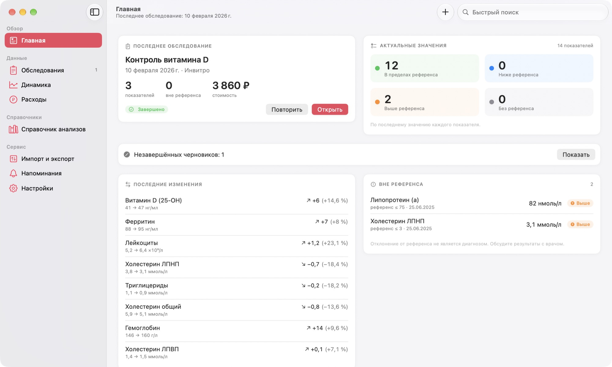

<details>
<summary>Тёмная тема</summary>

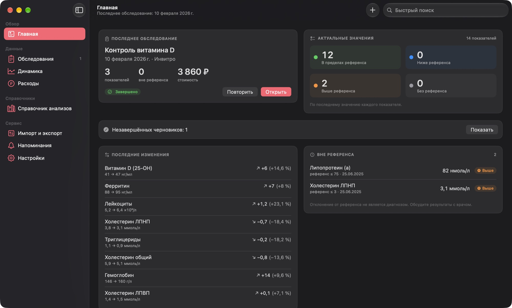

</details>

### 📋 Обследования

Нативная таблица macOS: сортировка по любой колонке, поиск по названию, лаборатории и показателям, фильтры
по статусу, лаборатории и году, «только с отклонениями», группировка по годам, панель сведений. Контекстное меню:
открыть в новом окне, редактировать, повторить, дублировать, экспорт в PDF, печать, сравнить два обследования.
Удаление клавишей ⌫, всегда с подтверждением.

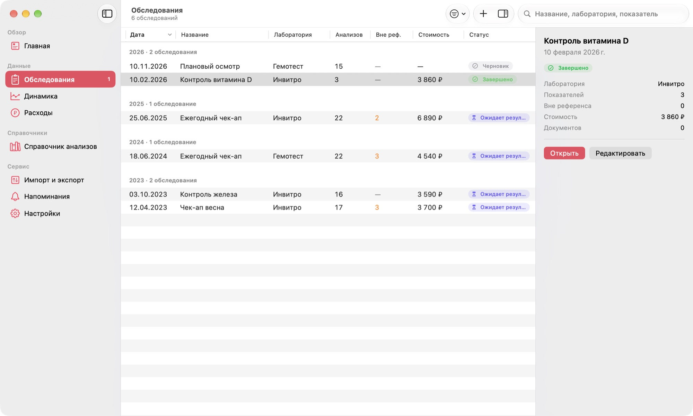

### 🧾 Карточка обследования

Сводка, результаты с референсом и предыдущим значением, панель показателя со шкалой референса, описанием
и историей. Вкладки «Динамика», «Расходы» с прошлой ценой и «Документы»: перетаскивание файлов, Quick Look
по пробелу, распознавание. Каждое обследование можно открыть в отдельном окне.

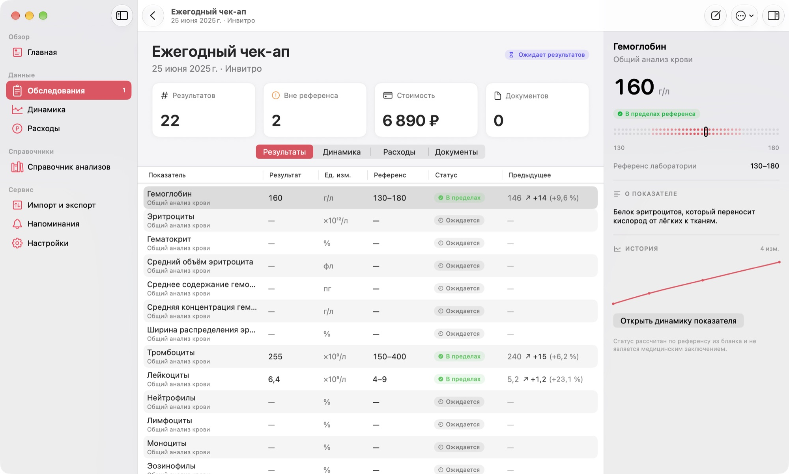

<details>
<summary>Вкладки «Динамика» и «Расходы»</summary>

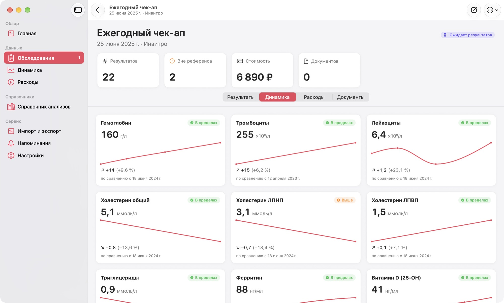
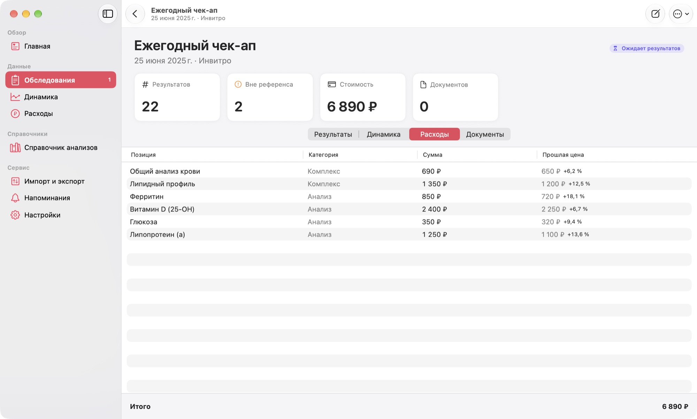

</details>

### ✍️ Табличный ввод результатов

Отдельное окно редактора (⌘N). Слева каталог с поиском, категориями, избранным и комплексами: общий анализ
крови, липидограмма, электролиты, общий анализ мочи. Компоненты комплекса можно выбрать по одному.
Справа таблица в стиле Numbers: результат, единица, границы референса, стоимость и живой статус.

- Tab, ↑, ↓ и Return переходят между ячейками.
- ⌘V вставляет целый столбец из Excel или Numbers; диапазон «3,5–5,5» заполняет обе границы.
- Массовое заполнение колонки, собственные показатели и услуги вроде взятия крови.
- ⌘S сохраняет черновик, а при закрытии окна черновик сохраняется сам.
- «Повторить прошлое» копирует только список анализов, без результатов и цен.
- Референсы подставляются только из прошлых бланков той же лаборатории.

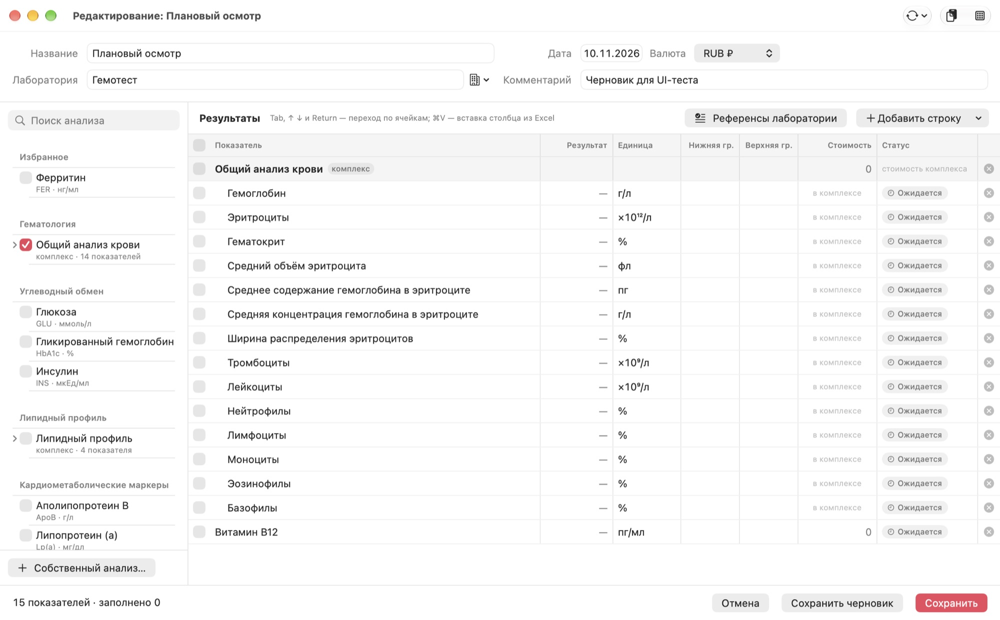

### 📈 Динамика

Большой график Swift Charts: значения, точки по статусу, зона референса лаборатории и подсказка при наведении.
Периоды 3 и 6 месяцев, год, 3 года и всё время. Статистика: первое и последнее значение, минимум, максимум,
среднее, абсолютное и процентное изменение. История измерений со ссылками на обследования, PDF и печать.

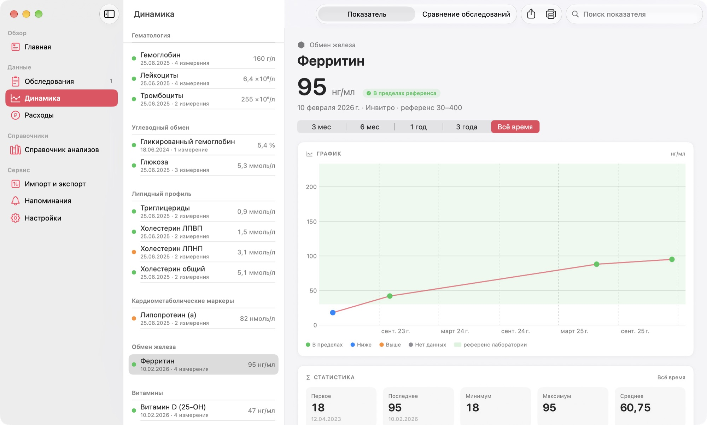

Значения в разных единицах пересчитываются только по корректным формулам: глюкоза, холестерин, креатинин,
витамин D, B12, HbA1c (NGSP ↔ IFCC) и другие. Липопротеин (а) в мг/дл и нмоль/л не пересчитывается,
такие измерения показываются отдельно.

<details>
<summary>Выбор единицы: глюкоза в ммоль/л и мг/дл</summary>

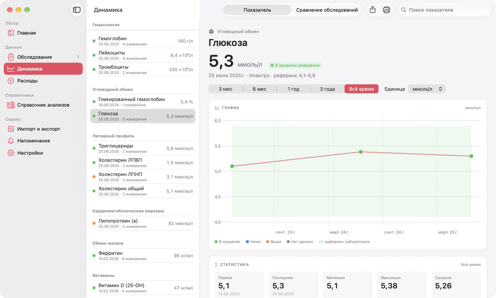

</details>

### ⚖️ Сравнение обследований

Два обследования в одной таблице: значения, единица, изменение и статусы до и после. Несопоставимые единицы
помечаются, а разница для них не считается. Фильтры «только общие», «изменился статус», «есть отклонения»
и экспорт в PDF.

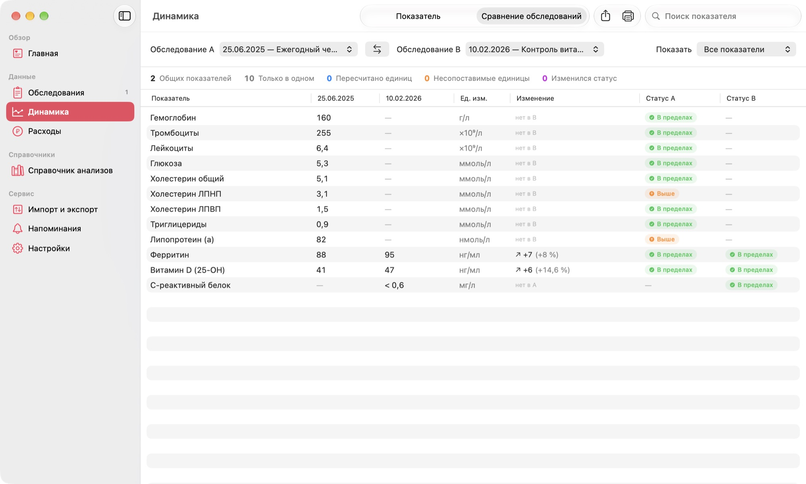

### 💳 Расходы и история цен

Денежные суммы на Decimal. Итоги за всё время, год и месяц, среднее за обследование, графики по месяцам,
годам и лабораториям. Суммы в разных валютах не складываются: общий итог появляется, только если задать
курсы в настройках. История цен на отдельные анализы: ферритин стоил 650 ₽, через год 850 ₽.

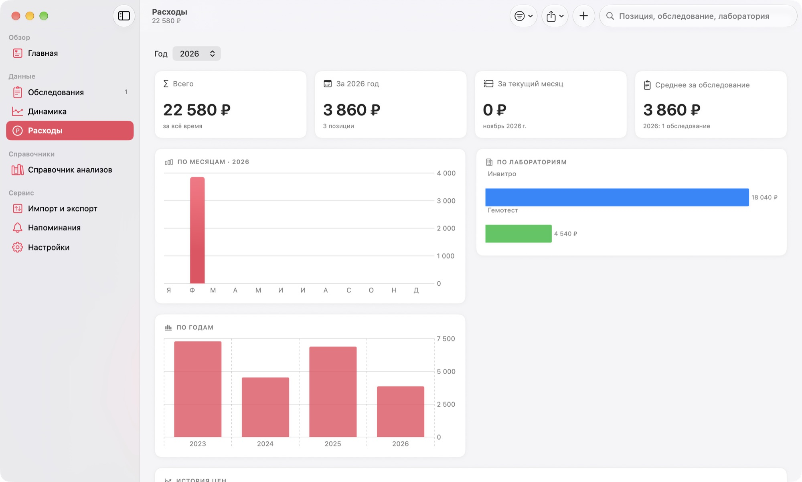

### 📚 Справочник анализов

63 встроенных показателя: общий анализ крови, глюкоза, HbA1c, холестерин, ЛПНП, ЛПВП, триглицериды, АЛТ, АСТ,
билирубин, ГГТ, креатинин, мочевина, мочевая кислота, ТТГ, ферритин, витамин D, B12, СРБ, электролиты, кальций,
магний, белок, альбумин, тестостерон, ГСПГ, ПСА, ApoB, липопротеин (а), гомоцистеин, инсулин и другие.
Избранное, собственные показатели и комплексы. Референсы в справочнике намеренно не задаются.

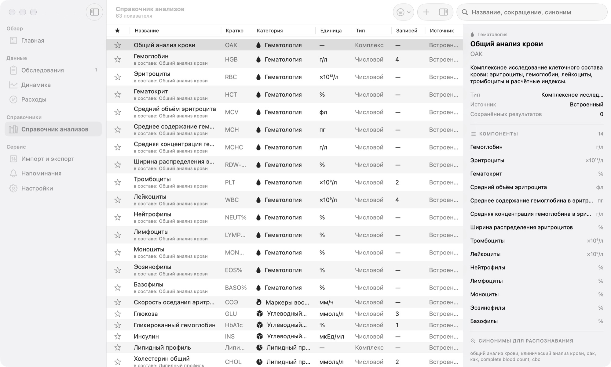

### 📄 Распознавание бланков

PDF, PNG, JPG и HEIC перетаскиванием или через ⌘I. Текст берётся из текстового слоя PDF или распознаётся
средствами macOS (Vision) прямо на Mac, на русском и английском. Находятся название, значение, единица,
референс, дата и лаборатория. В базу ничего не записывается, пока вы не проверите значения на экране рядом
с документом.

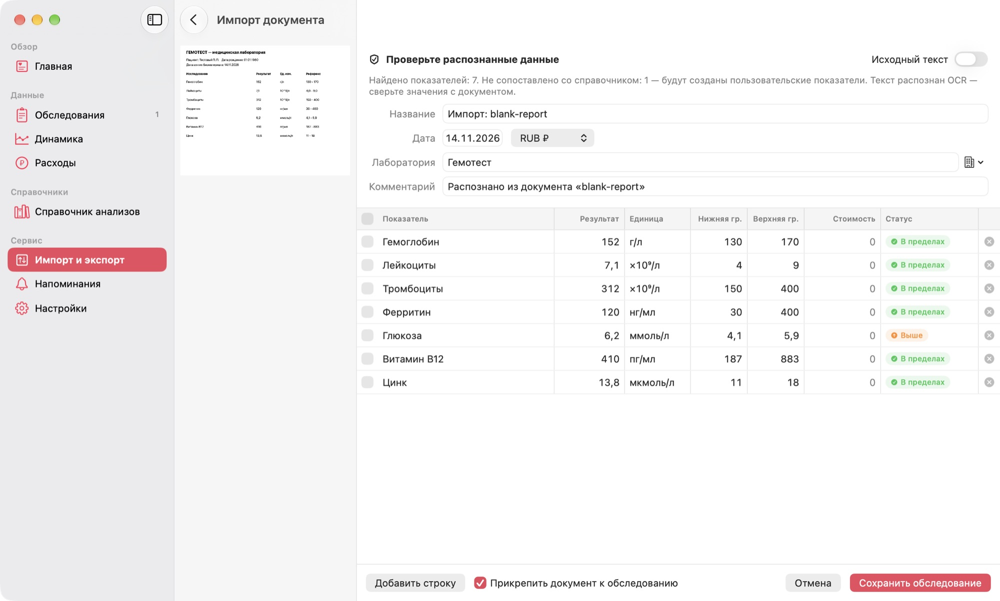

### 💾 Резервные копии, CSV и PDF

Полная резервная копия в JSON с версией схемы и контрольной суммой SHA-256, проверкой целостности и режимами
«объединить» или «заменить». Автоматические копии по расписанию. CSV для Excel и Numbers: экспорт результатов
и расходов, импорт с сопоставлением колонок. PDF-отчёты: обследование, сравнение, история показателя, финансы.

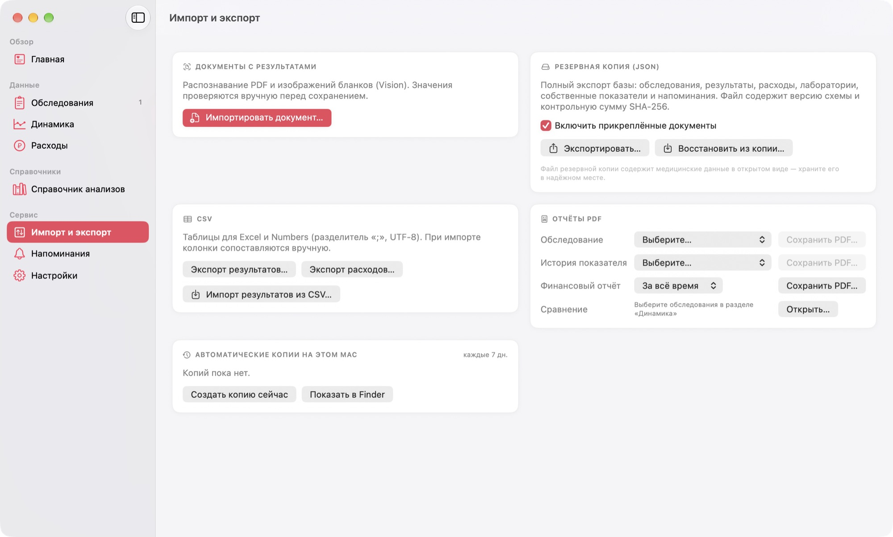

### 🔔 Напоминания

Повторная сдача анализов через месяц, 3, 6 или 12 месяцев с уведомлением macOS. В тексте уведомления только
название напоминания, без результатов.

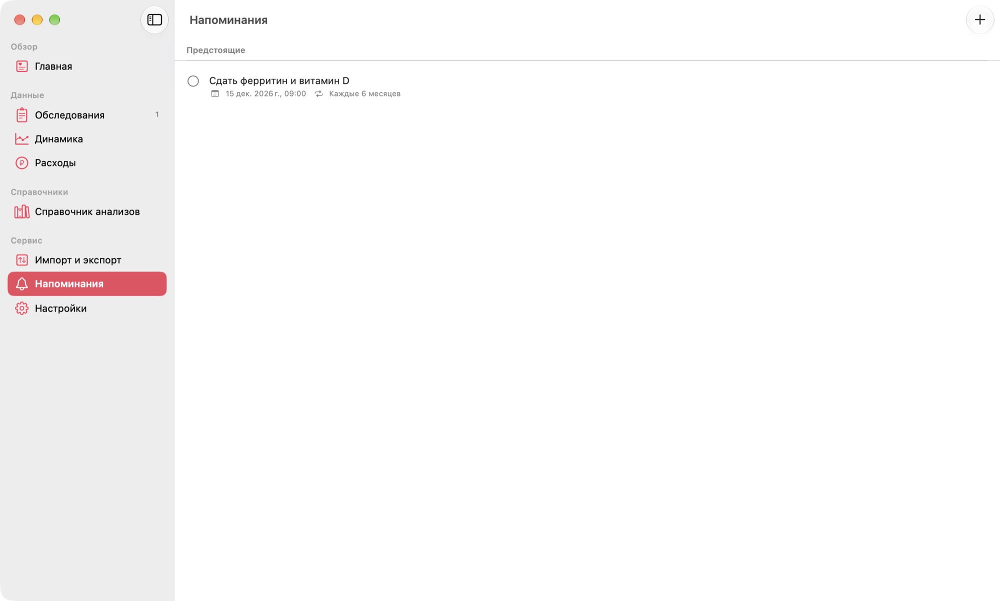

### ⚙️ Настройки

Профиль для PDF-отчётов, лаборатории, основная валюта и курсы, блокировка через Touch ID или пароль Mac
с тайм-аутом, автоматические копии, обслуживание данных.

<p align="center">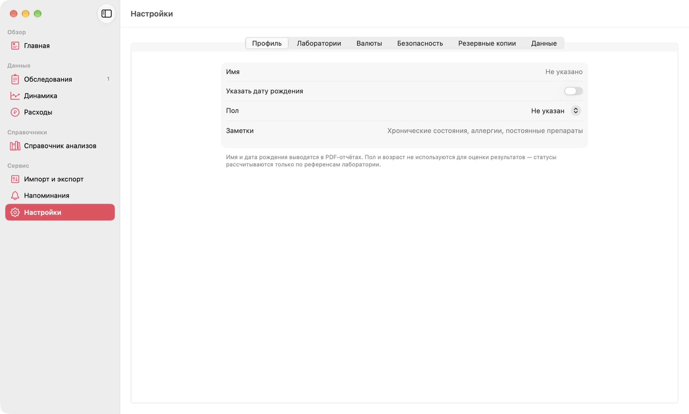</p>

### ⌨️ Горячие клавиши

Все разделы и действия с клавиатуры. Список есть в меню «Справка» (⌘?).

<details>
<summary>Список текстом</summary>

| Клавиши | Действие |
| --- | --- |
| ⌘N | Новое обследование |
| ⇧⌘N | Новое окно |
| ⌘1…⌘8 | Главная, Обследования, Динамика, Расходы, Справочник, Импорт и экспорт, Напоминания, Настройки |
| ⌘F | Поиск в текущем разделе |
| ⌘I | Импорт документа |
| ⌘E | Экспорт и отчёты |
| ⌘S | Сохранить черновик в редакторе |
| ⌘↩ | Сохранить обследование |
| ⌘P | Печать отчёта |
| ⌃⌘S | Боковая панель |
| ⌘, | Настройки |
| ⌘W | Закрыть окно |
| ⌫ | Удалить выбранное с подтверждением |
| Tab, ↑ ↓, ↩ | Переход по ячейкам таблицы ввода |
| ⌘? | Справка |

</details>

---

## Медицинская корректность и конфиденциальность

- Приложение не ставит диагнозов и не назначает лечение. Рост или снижение показателя показывается нейтрально,
  без оценки «лучше» или «хуже».
- Статус считается только по референсу из бланка конкретной лаборатории. Нет референса — «Нет данных для оценки».
  Значения вида «<0,5» оцениваются, только если весь возможный интервал однозначно попадает в одну зону.
- Каждый результат хранит свои название, единицу и референс, поэтому история не меняется при правке справочника.
- Данные хранятся только на Mac, в песочнице приложения. Регистрации и сервера нет, сетевых запросов нет,
  медицинские значения не пишутся в системный журнал. Документы лежат файлами с правами только владельца.
- Удаление всегда с подтверждением, перед удалением всех данных создаётся страховочная копия.

## Установка

Готовой сборки на странице Releases пока нет: приложение собирается из исходников за пару минут.

1. Установите Xcode 16 или новее и откройте проект:

   ```bash
   open Vitae.xcodeproj
   ```

2. Выберите схему **Vitae** и нажмите Run (⌘R). Сборка подписывается локально («Sign to Run Locally»),
   аккаунт разработчика не нужен.

Чтобы положить приложение в «Программы», соберите Release и скопируйте его:

```bash
xcodebuild -project Vitae.xcodeproj -scheme Vitae -configuration Release -derivedDataPath build build
```

```bash
cp -R build/Build/Products/Release/Vitae.app /Applications/
```

## Для разработчиков

<details>
<summary><b>Сборка и подпись</b></summary>

Нужны Xcode 16+ и macOS 14+. Сторонних зависимостей нет: только системные фреймворки (SwiftUI, SwiftData,
Swift Charts, PDFKit, Vision, Quick Look, UserNotifications, LocalAuthentication, CryptoKit).

Приложение работает в песочнице с правами на выбранные пользователем файлы и печать
(`Config/Vitae.entitlements`). Для распространения нужен Developer ID: в Target **Vitae** → Signing &
Capabilities выберите свой Team, при необходимости смените Bundle ID (`com.mrgsdev.Vitae`) на свой
и нотарифицируйте сборку.

</details>

<details>
<summary><b>Тесты</b></summary>

Unit-тесты на Swift Testing: 72 теста в 14 наборах. Проверяются статусы и референсы, разбор чисел,
конвертация единиц, динамика, сравнение, расходы, табличный ввод, хранилище, файлы, JSON-бэкап
(в том числе подмена данных и будущая версия формата), CSV, PDF, OCR с полным циклом Vision и повторное
открытие базы на диске.

```bash
xcodebuild -project Vitae.xcodeproj -scheme Vitae -destination 'platform=macOS,arch=arm64' test -only-testing:VitaeTests
```

UI-тесты на XCTest: навигация, создание обследования через таблицу, черновик по ⌘S, вкладки карточки, динамика
и сравнение, меню, окно настроек, минимальный размер окна. Для них macOS должна разрешить режим автоматизации:
один раз запустите UI-тесты из Xcode и подтвердите паролем или выполните

```bash
sudo automationmodetool enable-automationmode-without-authentication
```

</details>

<details>
<summary><b>Структура проекта</b></summary>

```
Vitae/
  App/          точка входа, окна, меню и горячие клавиши, навигация, общее окружение
  Core/         локаль, форматирование, разбор чисел, настройки, журнал без медицинских данных
  Data/
    Persistence/  версионированная схема SwiftData и план миграций, папки Application Support
    Repositories/ сохранение обследований из черновика, повтор, дублирование, удаление; справочник
    Seed/         встроенный справочник и тестовый набор данных для UI-тестов (только Debug)
  Domain/
    Models/       UserProfile, Laboratory, LabTest, Examination, TestResult, Expense, Attachment, Reminder
    Types/        статусы, референсы, разбор значений, категории, валюты
    Logic/        оценка по референсу, конвертация единиц, динамика, сравнение, расходы, сопоставление названий
    Draft/        черновик обследования, проверка, вставка и массовое заполнение таблицы
  Features/     Dashboard, Examinations, TestCatalog, TestResults, Dynamics, Comparison, Expenses,
                DocumentImport, ImportExport, Reminders, Settings
  Services/     файлы, JSON-бэкап, CSV, PDF-отчёты, OCR и разбор бланков, уведомления, блокировка, печать
  Shared/       тема, общие компоненты, мосты к AppKit
  Resources/    иконка и цвет акцента
Tests/
  VitaeTests/   unit-тесты (Swift Testing)
  VitaeUITests/ UI-тесты (XCTest)
Config/         права приложения
```

Расчёты работают с неизменяемыми снимками (`ResultSnapshot`, `ExpenseSnapshot`), поэтому покрываются тестами
без базы данных. Синонимы для распознавания и молярные массы для пересчёта единиц лежат
в `Vitae/Data/Seed/CatalogSeedData.swift` и `Vitae/Domain/Logic/UnitConverter.swift`.

</details>

<details>
<summary><b>Отладка</b></summary>

- Технический журнал без медицинских данных: `log stream --predicate 'subsystem == "Vitae"'`
- Данные приложения: `~/Library/Containers/com.mrgsdev.Vitae/Data/Library/Application Support/Vitae/`
  (`Vitae.store`, `Attachments/`, `Backups/`).
- Аргументы запуска (Scheme → Run → Arguments, только Debug):
  - `-uiTesting`: база в памяти, реальные данные не затрагиваются;
  - `-uiTestingFixture`: заполнить тестовыми обследованиями;
  - `-uiTestingSection examinations`: открыть раздел (`dashboard`, `dynamics`, `expenses`, `catalog`, …);
  - `-uiTestingAppearance light` или `dark`: тема;
  - `-uiTestingEditor new`, `edit` или `repeat`: открыть редактор;
  - `-uiTestingImport /путь/к/бланку.png`: сразу открыть распознавание документа.

</details>

## Лицензия

[MIT](LICENSE).

## Отказ от ответственности

* Программа предоставляется «как есть».
* Vitae не является медицинским изделием, не ставит диагнозов и не назначает лечение.
* Статусы рассчитываются по референсам из бланков и не заменяют консультацию врача.
* Распознавание бланков может ошибаться: сверяйте значения с документом.
* Решения о здоровье принимайте вместе с врачом.
