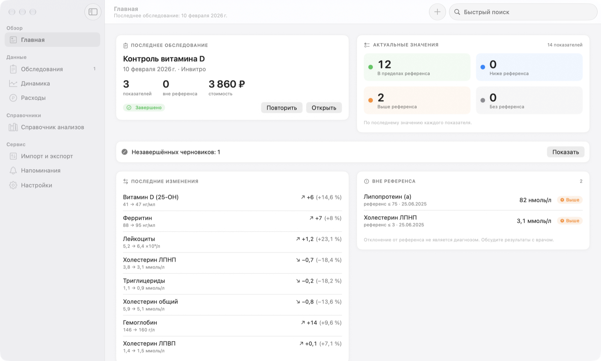

# Vitae для macOS

Нативное macOS-приложение для многолетнего хранения и анализа личных лабораторных анализов: обследования, результаты с референсами конкретной лаборатории, динамика показателей, сравнение обследований, расходы и история цен, распознавание бланков (OCR), резервные копии и отчёты.

Приложение работает полностью локально: без регистрации, сервера и сетевых запросов.



## Требования

- macOS 14 Sonoma или новее, приоритет — Apple Silicon.
- Xcode 16+ (проверено на Xcode 27.2, Swift 6.4, режим языка Swift 5).
- Технологии: SwiftUI, SwiftData, Swift Charts, AppKit, PDFKit, Vision, Quick Look, UserNotifications, LocalAuthentication, CryptoKit, Swift Testing / XCTest.

## Сборка и запуск

```bash
open Vitae.xcodeproj
```

Или из командной строки:

```bash
xcodebuild -project Vitae.xcodeproj -scheme Vitae -configuration Release -destination 'platform=macOS,arch=arm64' build
```

Подпись — «Sign to Run Locally» (ad-hoc). Для распространения нужен Developer ID и нотаризация.

## Архитектура

```
Vitae/
├── App/            Точка входа, окна (WindowGroup), меню и горячие клавиши, навигация, окружение
├── Core/           Локаль, форматирование, разбор чисел, настройки, журнал без медданных
├── Data/
│   ├── Persistence/   Версионированная схема SwiftData (V1) и план миграций, каталоги Application Support
│   ├── Repositories/  ExaminationStore (черновики ↔ модели, повтор, дублирование, удаление), CatalogStore
│   └── Seed/          Встроенный справочник (63 показателя) и сидер
├── Domain/
│   ├── Models/        UserProfile, Laboratory, LabTest, Examination, TestResult, Expense, Attachment, Reminder
│   ├── Types/         Статусы, референсы, разбор значений, категории, валюты
│   ├── Logic/         Оценка по референсу, конвертация единиц, динамика, сравнение, расходы, сопоставление названий
│   └── Draft/         Черновик обследования, валидация, табличные операции (вставка, массовое заполнение)
├── Features/       Dashboard, Examinations, TestCatalog, TestResults, Dynamics, Comparison, Expenses,
│                   DocumentImport, ImportExport, Reminders, Settings (Views / ViewModels / Components)
├── Services/       Файлы, JSON-бэкап, CSV, PDF-отчёты, OCR (Vision), разбор бланков, уведомления, блокировка, печать
├── Shared/         Тема (светлая/тёмная), общие компоненты, мосты AppKit (поиск ⌘F, монитор клавиш, PDFKit, Quick Look)
└── Resources/      Иконка и цвет акцента
Tests/
├── VitaeTests/    Unit-тесты (Swift Testing)
└── VitaeUITests/  UI-тесты (XCTest)
```

Расчёты (статусы, динамика, сравнение, расходы) работают с неизменяемыми снимками (`ResultSnapshot`, `ExpenseSnapshot`), поэтому покрываются тестами без базы данных.

## Возможности

**Главное окно** — `NavigationSplitView`: боковая панель (Главная, Обследования, Динамика, Расходы, Справочник анализов, Импорт и экспорт, Напоминания, Настройки), `NavigationStack` в каждом разделе; пути и фильтры разделов сохраняются при переключении. Отдельные окна: редактор обследования, карточка обследования (можно открыть несколько), справка, настройки.

**Главная** — последнее обследование, сводка по последним значениям (в пределах / ниже / выше / без референса), последние изменения (предыдущее → текущее, абсолютная и процентная разница), отклонения, расходы за год, напоминания, быстрый поиск по обследованиям и показателям.

**Обследования** — таблица macOS: сортировка по всем колонкам, поиск, фильтры (статус, лаборатория, год, только с отклонениями), группировка по годам, множественный выбор, контекстное меню (открыть, открыть в новом окне, редактировать, повторить, дублировать, PDF, печать, сравнить два, удалить), удаление клавишей ⌫ с подтверждением, панель сведений.

**Редактор обследования** (отдельное окно) — каталог с поиском, категориями, избранным и комплексами (ОАК, липидограмма, электролиты, ОАМ — с выбором отдельных компонентов); табличный ввод в стиле Numbers: результат, единица, границы референса, стоимость, живой статус; Tab / ↑ / ↓ / Return между ячейками; вставка столбца из Excel по ⌘V (диапазон «3,5–5,5» заполняет обе границы); массовое заполнение; собственные показатели и услуги (взятие крови); черновик по ⌘S, автосохранение черновика при закрытии окна; «Повторить прошлое» копирует только список исследований. Референсы подставляются только из прошлых бланков той же лаборатории.

**Карточка обследования** — сводка, вкладки «Результаты» (с предыдущим значением и панелью сведений: шкала референса, описание, история), «Динамика», «Расходы» (с прошлой ценой), «Документы» (перетаскивание, Quick Look по пробелу, распознавание, сохранение копии, удаление).

**Динамика** — список показателей, большой график Swift Charts с зоной референса лаборатории и подсказкой при наведении, периоды (3 мес, 6 мес, 1 год, 3 года, всё время), выбор единицы, статистика (первое, последнее, минимум, максимум, среднее, абсолютное и процентное изменение), история измерений, PDF и печать.

**Сравнение** — два обследования в таблице: пересчёт сопоставимых единиц, «несопоставимые единицы» без вычисления разницы, изменения статусов, фильтры, PDF.

**Расходы** — Decimal, раздельные итоги по валютам (суммы в разных валютах не складываются; приблизительный итог — только по курсам, заданным вручную), за всё время / год / месяц, среднее за обследование, графики по месяцам, годам и лабораториям, история цен на отдельные анализы (например, ферритин 650 ₽ → 850 ₽), таблица всех расходов, отдельные расходы, финансовые отчёты.

**Справочник** — 63 встроенных показателя (все из ТЗ: ОАК, глюкоза, HbA1c, холестерин, ЛПНП, ЛПВП, триглицериды, АЛТ, АСТ, билирубин, ГГТ, креатинин, мочевина, мочевая кислота, ТТГ, ферритин, витамин D, B12, СРБ, электролиты, кальций, магний, белок, альбумин, тестостерон, ГСПГ, ПСА, ApoB, Lp(a), гомоцистеин, инсулин и др.), избранное, фильтры, собственные показатели и комплексы, удаление пользовательских показателей с сохранением истории. Референсы в справочнике намеренно не задаются.

**Импорт документов (OCR)** — PDF, PNG, JPG, HEIC перетаскиванием или через панель открытия; текстовый слой PDF либо Vision (русский и английский); распознаются название, значение, единица, референс, дата и лаборатория; отдельный экран проверки с предпросмотром — в базу ничего не пишется до подтверждения.

**Импорт и экспорт** — полный JSON-бэкап (версия формата и схемы, SHA-256, проверка целостности, режимы «объединить» / «заменить»), CSV-экспорт результатов и расходов, CSV-импорт с сопоставлением колонок, PDF-отчёты (обследование, сравнение, история показателя, финансы), автоматические резервные копии.

**Напоминания** — повтор (месяц, 3, 6, 12 месяцев), локальные уведомления без медицинских данных в тексте.

**Настройки** — профиль, лаборатории, валюты и курсы, блокировка (Touch ID / пароль Mac, тайм-аут), резервные копии, обслуживание данных (неиспользуемые файлы, удаление всех данных с двойным подтверждением и страховочной копией).

### Горячие клавиши и меню

| Сочетание | Действие |
|---|---|
| ⌘N | Новое обследование |
| ⇧⌘N | Новое окно |
| ⌘F | Поиск в текущем разделе |
| ⌘I | Импорт документа |
| ⌘E | Экспорт и отчёты |
| ⌘S | Сохранить черновик (в редакторе) |
| ⌘↩ | Сохранить обследование |
| ⌘P | Печать текущего отчёта |
| ⌘1…⌘8 | Разделы |
| ⌃⌘S | Боковая панель |
| ⌘, / ⌘W / ⌘Q | Настройки / закрыть окно / выйти (стандартные) |
| ⌫ | Удалить выбранное с подтверждением |

⌘I и ⌘E в текстовых редакторах обычно заняты «Курсивом» и «Использовать выделенное для поиска»; в Vitae нет меню форматирования и подменю «Найти», поэтому конфликтов нет. Меню: Vitae (о программе, настройки, скрыть, выйти), Файл, Правка (стандартные Undo/Redo/Cut/Copy/Paste/Select All + «Найти…»), Вид (боковая панель, разделы), Окно (стандартное), Справка.

## Медицинская корректность и безопасность

- Приложение не ставит диагнозов и не назначает лечение; изменения показываются нейтрально, без оценки «лучше/хуже».
- Статус рассчитывается только по референсу из бланка конкретной лаборатории; без референса — «Нет данных для оценки». Значения вида «<0,5» оцениваются только если весь возможный интервал однозначно попадает в зону.
- Результаты хранят собственные снимки названий, единиц и референсов.
- Конвертация единиц — только по корректным формулам (молярные массы, HbA1c NGSP↔IFCC, инсулин); Lp(a) мг/дл ↔ нмоль/л не пересчитывается.
- Данные — в песочнице приложения (Application Support), документы — файлами с правами только владельца, не в базе. Медицинские данные не пишутся в журнал. Удаление — только с подтверждением.

## Тестирование

```bash
xcodebuild -project Vitae.xcodeproj -scheme Vitae -destination 'platform=macOS,arch=arm64' test -only-testing:VitaeTests
```

Unit-тесты: 72 теста в 14 наборах — статусы и референсы, разбор чисел, конвертация единиц, динамика, сравнение, расходы, табличный ввод, хранилище обследований, файлы, JSON-бэкап (в т. ч. подмена данных и будущая версия формата), CSV, PDF, OCR (парсер и полный цикл Vision на отрисованном бланке), схема и повторное открытие хранилища на диске.

UI-тесты (`VitaeUITests`): навигация по разделам (клики и ⌘1…⌘8), создание обследования через табличный ввод, черновик по ⌘S, вкладки карточки, динамика и сравнение, наличие пунктов меню, окно настроек, минимальный размер окна. Запускаются с хранилищем в памяти (`-uiTesting`) и тестовым набором данных (`-uiTestingFixture`, только в Debug).

Для запуска UI-тестов macOS требует разрешить режим автоматизации. Достаточно один раз запустить UI-тесты из Xcode и подтвердить запрос паролем, либо выполнить в Терминале:

```bash
sudo automationmodetool enable-automationmode-without-authentication
```

## Известные ограничения

- Схема данных — версия 1; план миграций подготовлен, этапов миграции пока нет. Формат резервной копии — версия 1.
- OCR основан на эвристиках: многострочные названия, повёрнутые сканы и нестандартные бланки могут потребовать ручной правки на экране проверки. Распознаётся до 10 страниц PDF.
- Сопоставление «единица ↔ единица» поддерживает распространённые записи (кириллица и латиница); пересчёт между массовой и молярной концентрацией — только для показателей с известной молярной массой.
- Курсы валют задаются вручную; автоматической загрузки нет (приложение не выходит в сеть).
- SwiftUI не позволяет перехватить закрытие окна, поэтому редактор при закрытии с несохранёнными изменениями сохраняет черновик автоматически, а не задаёт вопрос (кнопка «Отмена» спрашивает).
- Отмена (⌘Z) действует для текстовых полей и операций в базе; после удаления записей с файлами история отмены очищается, чтобы не восстановить запись без файла.
- Класс защиты файлов на Mac зависит от оборудования; для шифрования данных на диске включите FileVault.
- macOS не поддерживает Dynamic Type; масштабирование интерфейса следует системным настройкам дисплея, вёрстка адаптируется к размеру окна (минимум 980 × 620).
